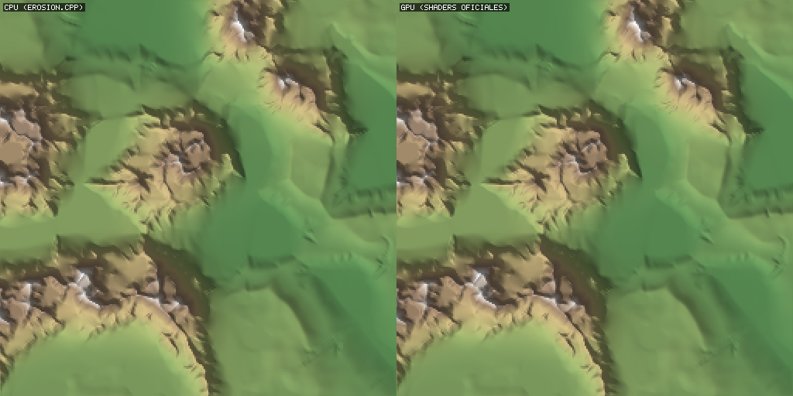
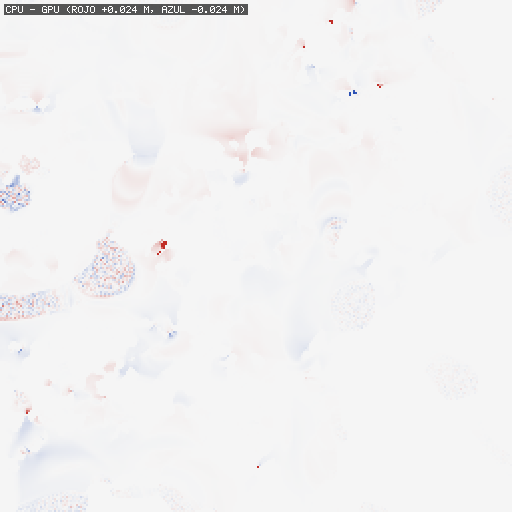
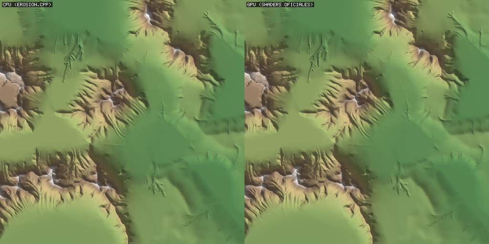
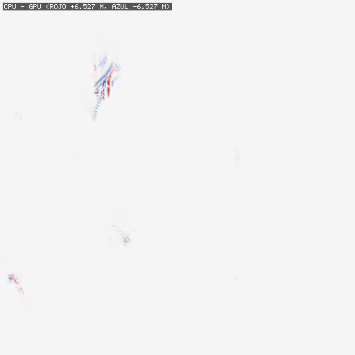

# Validacion contra la reproduccion oficial

Shaders originales de https://github.com/H-Schott/MultiScaleErosion (data/shaders, SHA-256 en tests/reference/SHA256SUMS.txt), ejecutados en la GPU con Vulkan y encadenados como `PredefinedErosion()` de su `main.cpp`: cada proceso empieza con los buffers de agua y sedimento en cero, el terreno pasa de uno a otro, caja `Box2(Vector2::Null, 10 * 1000)` (de -10 km a 10 km).

Dispositivo: llvmpipe (LLVM 20.1.2, 256 bits). CPU: Intel(R) Xeon(R) Processor @ 2.10GHz (2 hilos).

## A. Una resolucion (257 x 257), receta completa 3000 / 600 / 2000

| Medida | Valor |
|---|---|
| Muestras por lado | 257 |
| Relieve del resultado | 162.60 m |
| Cambio medio respecto a T0 | 4.740 m |
| Error maximo | 0.0243 m |
| RMSE | 0.0008 m (0.0005% del relieve) |
| Muestras con error < 1 cm | 99.93% |
| Muestras con error < 10 cm | 100.00% |
| Correlacion del cambio (CPU vs GPU) | 1.000000 |
| Tiempo CPU / GPU (lavapipe o la GPU real) | 31.6 s / 56.2 s |

Resultado: **aprobado** (criterio: RMSE < 0.2% del relieve y error maximo < 5% del relieve).

## B. Multiescala 129 -> 257 -> 513 (receta del paper por nivel)

Niveles: 129 (3000/600/2000), 257 (1500/1000/700), 513 (700/2000/200).

### Upsampling lineal en las dos ramas

| Medida | Valor |
|---|---|
| Muestras por lado | 513 |
| Relieve del resultado | 152.54 m |
| Cambio medio respecto a T0 | 8.910 m |
| Error maximo | 6.5270 m |
| RMSE | 0.1510 m (0.0990% del relieve) |
| Muestras con error < 1 cm | 96.29% |
| Muestras con error < 10 cm | 98.68% |
| Correlacion del cambio (CPU vs GPU) | 0.999919 |
| Tiempo CPU / GPU (lavapipe o la GPU real) | 105.6 s / 74.2 s |

Resultado: **aprobado** (criterio: RMSE < 0.3% del relieve).

### Upsampling bicubico en las dos ramas

| Medida | Valor |
|---|---|
| Muestras por lado | 513 |
| Relieve del resultado | 154.19 m |
| Cambio medio respecto a T0 | 8.882 m |
| Error maximo | 3.7874 m |
| RMSE | 0.0429 m (0.0278% del relieve) |
| Muestras con error < 1 cm | 98.06% |
| Muestras con error < 10 cm | 99.65% |
| Correlacion del cambio (CPU vs GPU) | 0.999993 |
| Tiempo CPU / GPU (lavapipe o la GPU real) | 103.3 s / 74.4 s |

Resultado: **aprobado** (criterio: RMSE < 0.3% del relieve).

### Que cambia el tipo de upsampling (CPU bicubico contra CPU lineal)

| Medida | Valor |
|---|---|
| Muestras por lado | 513 |
| Relieve del resultado | 154.19 m |
| Cambio medio respecto a T0 | 8.882 m |
| Error maximo | 12.2976 m |
| RMSE | 0.6102 m (0.3958% del relieve) |
| Muestras con error < 1 cm | 22.61% |
| Muestras con error < 10 cm | 61.90% |
| Correlacion del cambio (CPU vs GPU) | 0.998688 |

El paper describe un upsampling bicubico; `ScalarField2::SetResolution` del repo oficial termina usando `Value()`, que es bilineal en las dos ramas del `if`. El proyecto usa bicubico por defecto (pendientes continuas entre celdas) y deja el lineal como opcion (`erosion_upsampling`).

